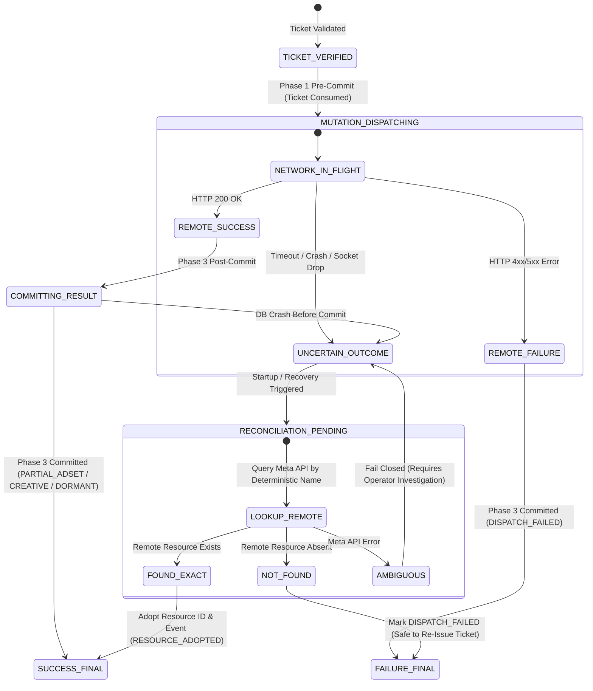
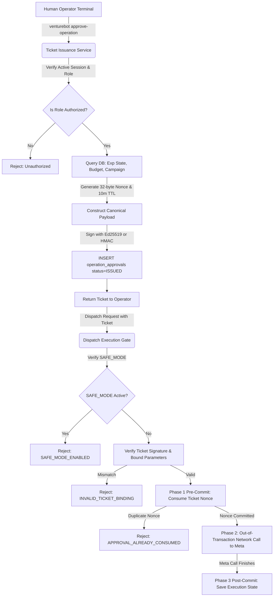
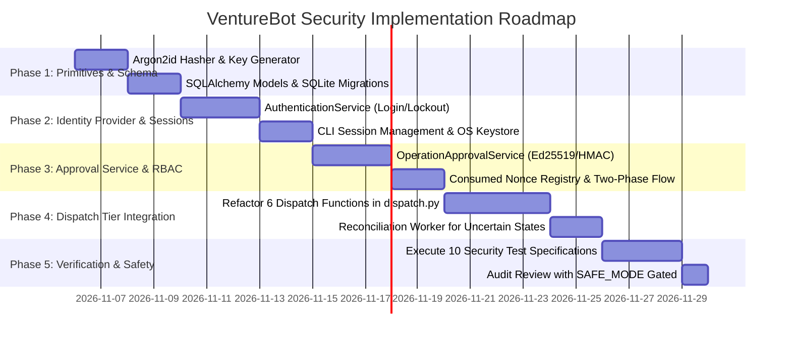

# VentureBot — Step 90.16.1: Security Architecture Corrections Specification

**Document Version:** 1.0.0 (Design-Only Specification)  
**Target Repository:** `E:\Project Folder\venturebot`  
**Safety Gate:** `VENTUREBOT_SAFE_MODE=true` (Preserved and Enforced)  
**Execution Context:** Design and Audit Review. Zero application source code modified. Zero database schemas altered. Zero live Meta API requests.

---

## 1. Executive Summary & Defect Correction Log

Step 90.16 proposed an initial architectural sketch for trusted operator authentication. A critical architectural review identified several foundational design defects, unrealistic cryptographic claims, transaction boundary flaws, and operating system boundary oversights.

This document serves as the authoritative, corrected security architecture specification for Step 90.16.1.

### 1.1 Corrected Design Defects Summary

| Architectural Area | Step 90.16 Flawed Proposal | Step 90.16.1 Corrected Design |
| :--- | :--- | :--- |
| **Transaction Boundary** | Kept SQLite database transaction open during remote HTTP calls to Meta Graph API. | **Decoupled Two-Phase Out-of-Transaction Execution:** Ticket is atomically consumed and recorded as `MUTATION_DISPATCHING` in a dedicated local transaction *before* network I/O. Remote result is committed in a separate post-execution transaction. |
| **Crash & Timeout Reconciliation** | Naively assumed atomic rollback handles failure; ignored orphaned remote resources. | **State-Driven Double-Checked Reconciliation:** If process crashes mid-network request, state remains `MUTATION_DISPATCHING`. Subsequent recovery inspects Meta via deterministic lookup, adopting created resources without creating duplicates. |
| **Cryptographic Claims** | Claimed HMAC-SHA256 provides "cryptographic non-repudiation." | **Accurate Cryptographic Taxonomy:** HMAC provides symmetric data integrity and tamper-evidence against non-keyholders, but **cannot** provide non-repudiation because the application shares the key. Human non-repudiation requires asymmetric public-key signatures (Ed25519). |
| **Windows OS Threat Boundary** | Claimed Windows Credential Manager / DPAPI prevents malicious processes from stealing secrets. | **OS Security Reality:** DPAPI and Credential Manager decrypt credentials for *any* process running under the same Windows logon token (`uvish`). Same-user malware is formally identified as outside the software-level boundary. |
| **Brute-Force & DoS** | Hard 5-attempt account lockout allowed trivial Denial-of-Service attacks against the Owner. | **Capped Exponential Delay + Non-Lockout Throttling + Offline Emergency Recovery Key:** Proportional delays without permanent account lockouts; offline split-key recovery procedure. |
| **RBAC Schema Consistency** | Mixed fixed roles with vague dynamic permission tables. | **Option 1 Selected (Fixed Role Enum in Code):** Roles (`VIEWER`, `OPERATOR`, `OWNER`) enforced by DB `CHECK` constraint; permissions enforced in application code to prevent database tampering privilege escalation. |
| **Dispatch Signatures** | Abstracted signatures without line-level source code alignment. | **Line-Level Audit of All 6 Dispatch Operations:** Directly audited all six actual dispatch functions and their underlying Meta mutation call paths in `dispatch.py`. |

---

## 2. Section A: Remote Mutation and Database Transaction Boundary

### 2.1 The Anti-Pattern of Open Transactions During Remote Network Calls
In distributed systems interfacing with third-party web APIs (such as Meta Graph API), keeping a local database transaction open while executing an HTTP request is a severe failure mode:
1. **Connection Starvation & Deadlocks:** If Meta's API experiences high latency (5–30 seconds), SQLite or connection pools hold open write locks, blocking all other readers/writers.
2. **Ambiguous Commit Race:** If the remote POST succeeds on Meta's infrastructure but the local database transaction subsequently fails (disk I/O error, SQLite busy lock, power loss, OOM crash), the local transaction rolls back. The ticket appears unconsumed, yet the remote resource is live on Meta! A subsequent retry would trigger a second remote POST, creating duplicate campaigns, ad sets, or ads.
3. **Network Timeouts:** An HTTP read timeout does not mean the mutation failed; Meta may have successfully committed the ad set creation before the socket dropped.

### 2.2 Corrected Architecture: Decoupled Two-Phase Execution

```
[Phase 1: Pre-Commit (Local DB Transaction 1)]
  │ 1. Validate Operator Session & Permissions (RBAC)
  │ 2. Validate OperationApprovalTicket HMAC / Ed25519 signature & parameter bindings
  │ 3. INSERT INTO consumed_nonces (nonce, ticket_id, experiment_id, consumed_at)
  │ 4. UPDATE operation_approvals SET status = 'CONSUMED'
  │ 5. UPSERT external_executions SET status = 'MUTATION_DISPATCHING', dispatch_nonce = :nonce
  │ 6. COMMIT LOCAL DB TRANSACTION 1
  ▼
[Local DB Locks Fully Released]
  │
  ▼
[Phase 2: Network Execution (Out-of-Transaction)]
  │ 1. Evaluate VENTUREBOT_SAFE_MODE (Must be False to proceed)
  │ 2. Send HTTP POST to Meta Marketing API (create adset, creative, or ad)
  │ 3. Receive HTTP Response (Success or Error)
  ▼
[Phase 3: Post-Commit (Local DB Transaction 2)]
  │ 1. BEGIN LOCAL DB TRANSACTION 2
  │ 2. If HTTP Success:
  │      - UPDATE external_executions SET status = 'PARTIAL_*' / 'DEPLOYED_DORMANT', resource_id = :id
  │      - INSERT INTO external_execution_events (RESOURCE_CREATED)
  │    If HTTP Failure:
  │      - UPDATE external_executions SET status = 'DISPATCH_FAILED', last_error = :sanitized_err
  │      - INSERT INTO external_execution_events (DEPLOYMENT_FAILED)
  │ 3. COMMIT LOCAL DB TRANSACTION 2
```

### 2.3 Execution State Machine Specification



### 2.4 Handling Remote Success Followed by Local DB Failure (Scenario A Reconciliation)
If Meta creates the resource (e.g. ad set `120252176299999999`), but the worker process crashes before Phase 3 commits to SQLite:
1. The ticket nonce remains durably committed as `CONSUMED` in `consumed_nonces`. **The ticket can never be re-used.**
2. The execution record remains durably stored as `MUTATION_DISPATCHING` with the recorded parameters (target replacement name `VB-EXP-...-ADSET-v2`, campaign ID, etc.).
3. When recovery runs:
   - The system queries `external_executions` where `status == 'MUTATION_DISPATCHING'`.
   - It performs an explicit read-only idempotency lookup against Meta: `lookup_adset(campaign_id, name)`.
   - Meta returns `FOUND_EXACT` with ID `120252176299999999` in `PAUSED` status.
   - The reconciliation worker initiates a new transaction:
     - Updates `execution.adset_id = '120252176299999999'`.
     - Updates `execution.status = 'PARTIAL_ADSET'`.
     - Records `ExternalExecutionEvent(RESOURCE_ADOPTED, reason="Reconciled orphaned remote creation following uncommitted dispatch")`.
   - **Zero duplicate remote resources are created.**

---

## 3. Section B: Cryptographic Integrity vs. Human Non-Repudiation

### 3.1 Accurate Cryptographic Taxonomy: HMAC vs. Digital Signatures

| Property | Symmetric HMAC-SHA256 | Asymmetric Digital Signature (Ed25519) |
| :--- | :--- | :--- |
| **Key Architecture** | Single shared secret key $K_{\text{auth}}$ | Key pair: Private Signing Key $SK_{\text{op}}$ + Public Verification Key $PK_{\text{op}}$ |
| **Holder of Key** | Both the ticket issuer and ticket verifier | Only the human Operator holds $SK_{\text{op}}$; VentureBot holds only $PK_{\text{op}}$ |
| **Data Integrity** | **YES:** Detects any modification to payload | **YES:** Detects any modification to payload |
| **Tamper-Evidence** | **YES:** Unauthenticated attackers cannot forge | **YES:** Unauthenticated attackers cannot forge |
| **Cryptographic Non-Repudiation**| **NO:** The application itself possesses $K_{\text{auth}}$ and could theoretically forge tickets. Proves only that someone with $K_{\text{auth}}$ created the tag. | **YES:** Mathematically impossible for VentureBot or any third party to forge without $SK_{\text{op}}$. Proves authentic human operator authorization. |

### 3.2 Dual-Tier Signing Specification

To reconcile operational simplicity with cryptographic correctness, VentureBot defines two operational tiers:

#### Tier 1: Symmetric Application Ticket Tamper-Evidence (HMAC-SHA256)
- **Use Case:** Internal component binding (e.g. dispatch queue tickets, temporary internal job tokens).
- **Protection Provided:** Ensures the ticket parameters (budget, experiment, operation) were issued by the internal VentureBot ticket issuer and not altered in transit or memory.
- **Key Generation:** $256\text{-bit}$ CSPRNG key generated via `secrets.token_bytes(32)`.
- **Key Storage:** Stored in a root-owned, mode `0600` keyfile (`/etc/venturebot/auth.key` or DPAPI-protected user store), never in version control.
- **Key Rotation:** Key identifiers (`kid`). The ticket header includes `kid: "k2026_v1"`. The verifier maintains the current key and previous key for a 24-hour transition window.

#### Tier 2: Asymmetric Human Operator Non-Repudiation (Ed25519)
- **Use Case:** High-stakes live financial mutations (`pilot:activate`, budget increases beyond ₹200.00).
- **Protection Provided:** Genuine cryptographic non-repudiation. The Operator signs the approval payload on their workstation using their private key $SK_{\text{op}}$.
- **Key Architecture:**
  - Standard: **Ed25519** (RFC 8032 Edwards-curve Digital Signature Algorithm).
  - Operator Private Key ($SK_{\text{op}}$): Kept in operator possession (e.g. encrypted with operator passphrase, or on an FIDO2 / YubiKey hardware token).
  - Operator Public Key ($PK_{\text{op}}$): Registered in the `operators` table (`public_key_pem`) upon operator provisioning.
- **Verification:** VentureBot verifies:
  $$\text{Verify}(PK_{\text{op}}, \text{canonical\_payload}, \text{signature}) == \text{True}$$
  Because VentureBot does not possess $SK_{\text{op}}$, VentureBot cannot repudiate or simulate operator authorization.

---

## 4. Section C: Local Threat Model & Boundary Analysis

### 4.1 Threat Boundary Analysis Matrix

```
┌────────────────────────────────────────────────────────────────────────┐
│                        OUTSIDE SECURITY BOUNDARY                       │
│  - Malicious process running under same Windows user account (uvish)   │
│  - Windows Local Administrator / SYSTEM account                        │
│  - Kernel rootkits / Hardware memory bus inspection                   │
│  - Direct raw disk tampering with SQLite database file                 │
├────────────────────────────────────────────────────────────────────────┤
│                       PARTIALLY MITIGATED BOUNDARY                     │
│  - Theft of active session token (mitigated by short TTL & ticket req) │
│  - Stolen operator password (mitigated by lockout & offline recovery)  │
├────────────────────────────────────────────────────────────────────────┤
│                     FULLY MITIGATED SOFTWARE BOUNDARY                  │
│  - Unauthenticated local Python scripts / harnesses                    │
│  - Accidental operator clicks / scripts passing explicit_auth=True     │
│  - Replay of previously consumed approval tickets                      │
│  - In-flight parameter tampering (budget escalation, target switching) │
│  - Multi-threaded / cross-process concurrent creation races           │
│  - Mid-flight process crashes & network timeout reconciliation         │
└────────────────────────────────────────────────────────────────────────┘
```

### 4.2 The Windows DPAPI & Credential Manager Security Reality
- **Flawed Assumption in Step 90.16:** Claimed that saving secrets in Windows Credential Manager or DPAPI isolated them from malicious local scripts.
- **Corrected Analysis:**
  - Windows DPAPI encrypts data using a key derived from the user's login password.
  - **Any process executing under the same Windows user token (`uvish`) can invoke `CryptUnprotectData` or Windows Credential Manager APIs and successfully decrypt those secrets.**
  - If a developer machine runs an unvetted script, infected dependency, or rogue extension under user `uvish`, that process has identical access to DPAPI secrets and SQLite database files as the VentureBot application.
- **Formal Boundary Declaration:**
  - Local software authentication protects against **unauthorized callers inside the software boundary** (e.g. unauthenticated scripts, rogue subagents, automated test runners, parameter confusion).
  - Protection against malicious software running under the *same OS user account* cannot be achieved by application-level Python code; it requires **Operating System Process Isolation** (e.g. dedicated Windows Service Account, AppContainer isolation, or Linux unprivileged daemon user `venturebot:venturebot`).

---

## 5. Section D: Redesigned Brute-Force & Denial-of-Service Protection

### 5.1 Elimination of Lockout-Based Denial-of-Service
A naive lockout mechanism (e.g. "lock account after 5 failed attempts") creates a severe vulnerability: an unauthenticated attacker or rogue local process can intentionally submit 5 invalid login attempts for user `owner`, permanently locking out the genuine human operator from controlling live ad spend or executing emergency stops.

### 5.2 Corrected Multi-Layer Rate-Limiting Architecture
1. **Capped Exponential Delay:**
   - Attempt 1: $0\text{ms}$ delay.
   - Attempt 2: $250\text{ms}$ delay.
   - Attempt 3: $500\text{ms}$ delay.
   - Attempt 4: $1,000\text{ms}$ delay.
   - Attempt 5: $2,000\text{ms}$ delay.
   - Attempts $\ge 6$: Capped at exactly $5,000\text{ms}$ delay.
2. **Account-Level Progressive Soft Lockout:**
   - Instead of a total account freeze, after 5 consecutive failures, enforce a progressive delay ($15\text{ seconds}$ per subsequent attempt).
   - Emergency-stop commands (`emergency:stop`) **do not require re-authentication** if an emergency stop token was previously pre-generated or if invoked via the safe emergency stop CLI channel.
3. **Generic Error Responses & Timing Safety:**
   - Response message: Always return `"Invalid username or password"`.
   - Never indicate whether the username exists.
   - Password hash verification must use constant-time comparison (`secrets.compare_digest` / Argon2 verification) to eliminate timing side-channels.

### 5.3 Secure Offline Emergency Owner Recovery Procedure
If the Owner genuinely forgets their password or authentication credentials become corrupted:
- **No Backdoor Principle:** The application must never include a hardcoded recovery backdoor.
- **Offline Master Recovery Key (Mnemonic/256-bit Key):**
  - Upon initial operator provisioning (`venturebot init-security`), the system generates an offline recovery key (a 256-bit high-entropy secret, output once as a 24-word BIP-39 mnemonic).
  - The hash of this recovery key is stored using Argon2id in `operators.recovery_key_hash`.
  - The human operator is instructed to store this mnemonic physically offline (e.g. written in a physical safe).
  - **Recovery Execution:**
    ```bash
    venturebot operator emergency-reset-password --username owner --recovery-mnemonic "word1 word2 ... word24"
    ```
  - The command verifies the mnemonic against `recovery_key_hash`, prompts for a new password, hashes it with Argon2id, revokes all active sessions, and records a `CRITICAL_SECURITY_AUDIT` event.

---

## 6. Section E: RBAC Schema Consistency & Selection

### 6.1 Architectural Trade-Off Analysis

| Dimension | Option 1: Fixed Role Enum in Application Code | Option 2: Normalized Roles & Permissions DB Tables |
| :--- | :--- | :--- |
| **Schema Complexity** | Very Low: Single `role` column in `operators` table with `CHECK (role IN ('VIEWER', 'OPERATOR', 'OWNER'))`. | High: 3 additional tables (`roles`, `permissions`, `role_permissions`) with foreign keys and join queries. |
| **Performance** | Extremely Fast: In-memory O(1) bitmask or set lookup. Zero extra SQL joins per dispatch. | Slower: Requires database joins on every permission evaluation or complex query caching. |
| **Tamper Resistance** | **Superior:** Direct database manipulation cannot alter role capabilities because permissions are hardcoded in application logic. | **Vulnerable:** An attacker with database write access can execute `INSERT INTO role_permissions` to elevate privileges. |
| **Flexibility** | Static: Adding a role or permission requires a tested code deployment. | Dynamic: Allows runtime creation of custom roles via admin UI. |

### 6.2 Decision: Option 1 Selected
For VentureBot's autonomous experimentation domain, role definitions are immutable architectural boundaries. **Option 1 (Fixed Role Enum with Code-Enforced Permissions)** is strictly selected.

### 6.3 Consistent Production SQL DDL

```sql
-- 1. Operators Table
CREATE TABLE operators (
    id TEXT PRIMARY KEY,                       -- UUID
    username TEXT NOT NULL UNIQUE,             -- Unique username
    password_hash TEXT NOT NULL,               -- Modular crypt Argon2id string
    recovery_key_hash TEXT NOT NULL,           -- Argon2id hash of offline recovery mnemonic
    public_key_pem TEXT NULL,                  -- Ed25519 Public Key (for Owner non-repudiation)
    role TEXT NOT NULL CHECK (role IN ('VIEWER', 'OPERATOR', 'OWNER')),
    is_active INTEGER NOT NULL DEFAULT 1,      -- 1 = True, 0 = False
    failed_login_attempts INTEGER NOT NULL DEFAULT 0,
    last_failed_attempt_at TIMESTAMP NULL,
    locked_until TIMESTAMP NULL,
    created_at TIMESTAMP NOT NULL,
    updated_at TIMESTAMP NOT NULL
);

-- 2. Operator Sessions Table
CREATE TABLE operator_sessions (
    id TEXT PRIMARY KEY,                       -- UUID
    operator_id TEXT NOT NULL REFERENCES operators(id) ON DELETE RESTRICT,
    session_token_hash TEXT NOT NULL UNIQUE,   -- SHA-256 hash of raw bearer token
    created_at TIMESTAMP NOT NULL,
    expires_at TIMESTAMP NOT NULL,             -- Hard 8-hour ceiling
    idle_expires_at TIMESTAMP NOT NULL,        -- Sliding 15-minute inactivity window
    revoked_at TIMESTAMP NULL,                 -- Timestamp of explicit logout
    client_info TEXT NULL
);
CREATE INDEX idx_sessions_token ON operator_sessions(session_token_hash);
CREATE INDEX idx_sessions_operator ON operator_sessions(operator_id);

-- 3. Operation Approvals Table
CREATE TABLE operation_approvals (
    id TEXT PRIMARY KEY,                       -- UUID
    operator_id TEXT NOT NULL REFERENCES operators(id) ON DELETE RESTRICT,
    experiment_id TEXT NOT NULL,               -- Bound experiment UUID
    operation TEXT NOT NULL,                   -- 'DEPLOY_DORMANT' | 'LOCK_SCHEDULE' | 'ACTIVATE_FLIGHT'
    tier TEXT NOT NULL CHECK (tier IN ('adset', 'creative', 'ad', 'flight', 'schedule')),
    recovery_version INTEGER NOT NULL,         -- e.g. 2
    max_authorized_budget_paise INTEGER NOT NULL, -- e.g. 20000 (₹200.00)
    campaign_id TEXT NOT NULL,                 -- Target Meta Campaign ID
    resource_name TEXT NOT NULL,               -- Target Resource Name
    nonce TEXT NOT NULL UNIQUE,                -- 32-byte cryptographic random hex
    signature_type TEXT NOT NULL CHECK (signature_type IN ('HMAC_SHA256', 'ED25519')),
    signature TEXT NOT NULL,                   -- Base64 signature
    status TEXT NOT NULL CHECK (status IN ('ISSUED', 'CONSUMED', 'REVOKED', 'EXPIRED')),
    issued_at TIMESTAMP NOT NULL,
    expires_at TIMESTAMP NOT NULL,             -- Hard 10-minute validity ceiling
    consumed_at TIMESTAMP NULL,
    consumed_by_execution_id TEXT NULL
);
CREATE INDEX idx_approvals_exp ON operation_approvals(experiment_id, operation, status);

-- 4. Consumed Nonces Table (Atomic Replay Elimination)
CREATE TABLE consumed_nonces (
    nonce TEXT PRIMARY KEY,                    -- Unique constraint guarantees atomic single-use
    operation_approval_id TEXT NOT NULL REFERENCES operation_approvals(id),
    experiment_id TEXT NOT NULL,
    consumed_at TIMESTAMP NOT NULL
);

-- 5. Security Audit Events Table (Append-Only)
CREATE TABLE security_audit_events (
    id TEXT PRIMARY KEY,                       -- UUID
    operator_id TEXT NULL REFERENCES operators(id),
    event_type TEXT NOT NULL,                  -- 'LOGIN_SUCCESS', 'APPROVAL_CONSUMED', etc.
    actor_username TEXT NOT NULL,
    details_json TEXT NOT NULL,
    created_at TIMESTAMP NOT NULL
);
CREATE INDEX idx_security_events ON security_audit_events(event_type, created_at);
```

---

## 7. Section F: Dispatch Integration & Actual Source Code Audit

### 7.1 Direct Inspection of Actual Functions in `backend/venturebot/execution/dispatch.py`

Every function in `dispatch.py` that can trigger or coordinate remote Meta mutations was audited at the source code level:

| # | Actual Method Name in Source | Lines in `dispatch.py` | Current Signature | Mutating Operations Executed on Meta |
| :- | :--- | :--- | :--- | :--- |
| **1** | `deploy_recovery_adset_dormant` | lines 739–1168 | `(session, experiment_id, spec, adapter=None, safe_mode=None, explicit_auth=False, version=2, auto_commit=True)` | `adapter.create_adset` (line 1093) |
| **2** | `deploy_recovery_creative_dormant` | lines 1169–1442 | `(session, experiment_id, spec, adapter=None, safe_mode=None, explicit_auth=False, auto_commit=True)` | `adapter.create_creative` (line 1367) |
| **3** | `deploy_recovery_ad_dormant` | lines 1443–1735 | `(session, experiment_id, spec, adapter=None, safe_mode=None, explicit_auth=False, auto_commit=True)` | `adapter.create_ad` (line 1642) |
| **4** | `deploy_recovery_dormant` | lines 1736–1796 | `(session, experiment_id, spec, adapter=None, safe_mode=None, explicit_auth=False, version=2, auto_commit=True)` | Composes 1, 2, and 3 sequentially |
| **5** | `lock_schedule` | lines 1889–1954 | `(session, experiment_id, target_start, target_end, adapter=None, safe_mode=None, explicit_auth=False)` | `adapter.update_adset_schedule` (line 1931) |
| **6** | `activate_recovery_flight` | lines 1955–2361 | `(session, experiment_id, adapter=None, safe_mode=None, explicit_auth=False, original_adset_id=None, auto_commit=True)` | `adapter.unpause_campaign` (line 2042), `adapter.unpause_adset` (line 2110), `adapter.unpause_ad` (line 2176) |

*(Note: Additionally, `emergency_pause_adset` (lines 2434–2777) and `emergency_stop` (lines 570–657) execute `adapter.pause_*` mutations; these are emergency circuit-breakers and follow the dedicated Emergency Stop policy).*

### 7.2 Integration Enforcement Design
In all six functions:
1. **Remove Caller-Supplied Flags:** Remove `explicit_auth: bool`.
2. **Require Authentication Parameters:** Add `session_token: str` and `approval_ticket: OperationApprovalTicket`.
3. **Execution Gate Sequence:**
   ```python
   # 1. Independent SAFE_MODE gate (Non-bypassable)
   if is_safe_mode_enforced(safe_mode):
       return Result(success=False, blocked=True, reason="SAFE_MODE_ENABLED")

   # 2. Authenticate session token
   auth_context = SecurityService.authenticate_session(session, session_token)
   
   # 3. RBAC permission verification
   SecurityService.enforce_permission(auth_context, required_permission)
   
   # 4. For activate_recovery_flight: Strictly require OWNER role
   if required_permission == "pilot:activate" and auth_context.role != Role.OWNER:
       return Result(success=False, blocked=True, reason="OWNER_ROLE_REQUIRED")

   # 5. Verify OperationApprovalTicket cryptographic signature & exact parameter bindings
   SecurityService.verify_ticket(approval_ticket, expected_experiment_id, expected_tier, expected_op, ...)

   # 6. Execute Two-Phase Commit with Double-Checked Locking (Section A)
   ```

---

## 8. Section G: Operation-Bound Approval Ticket Lifecycle



### 8.1 Exact Ticket Parameter Bindings
Every issued ticket is cryptographically locked to:
1. `operator_id`: UUID of the authenticated operator.
2. `experiment_id`: Must match target experiment (`49fde874-9387-5056-934c-51a9cfca164f`).
3. `operation`: Must match exact operation (`DEPLOY_DORMANT`, `LOCK_SCHEDULE`, `ACTIVATE_FLIGHT`).
4. `tier`: Must match exact tier (`adset`, `creative`, `ad`, `flight`).
5. `recovery_version`: Must match exact authorized version ($2$).
6. `max_authorized_budget_paise`: Strict ceiling in paise ($20000 = \text{₹}200.00$).
7. `campaign_id`: Exact remote Meta campaign ID (`120252176243860380`).
8. `resource_name`: Exact deterministic naming string (`VB-EXP-...-ADSET-v2`).
9. `expires_at`: Strict short-lived TTL ($10\text{ minutes}$ from issuance).
10. `nonce`: Cryptographically secure unique random string.

---

## 9. Section H: Comprehensive Security Test Design

The future implementation must be verified against the following 10 concrete security test specifications:

1. **Test DB Failure Before Remote Execution (Pre-Commit Failure):**
   - Inject simulated database connection drop during Phase 1 pre-commit.
   - Verify: Zero Meta API calls executed. Ticket remains `ISSUED` or rolled back cleanly. No orphaned remote resources.
2. **Test Remote Success Followed by DB Failure (Post-Commit Crash):**
   - Phase 1 commits ticket consumption (`status = MUTATION_DISPATCHING`). Meta API returns `200 OK`. Simulate immediate process crash before Phase 3 commits.
   - Verify: Ticket nonce remains durably committed as `CONSUMED`. Subsequent reconciliation finds existing remote resource and adopts it cleanly without creating a second resource.
3. **Test Remote Timeout with Uncertain Outcome:**
   - Simulate socket timeout on Meta POST request.
   - Verify: Local state remains `MUTATION_DISPATCHING`. Dispatch returns `blocked=True, reason="DISPATCH_TIMEOUT_PENDING_RECONCILIATION"`. Re-running does not invoke `create_*`, but enters read-only lookup adoption.
4. **Test Replay Rejection After Consumed Ticket:**
   - Attempt to execute `deploy_recovery_adset_dormant` twice with the same approval ticket.
   - Verify: First call succeeds; second call fails closed with `APPROVAL_ALREADY_CONSUMED` due to unique constraint on `consumed_nonces`.
5. **Test Concurrent Attempts to Consume Single Ticket:**
   - Launch two parallel threads synchronized by `threading.Barrier(2)` presenting the same ticket.
   - Verify: Exactly one thread succeeds in Phase 1 commit; second thread encounters constraint violation and fails closed. Meta create endpoint called exactly once.
6. **Test Same-User Malicious Process Limitations:**
   - Design test verifying that file-level permissions and OS-level boundary distinctions are documented and that DPAPI-protected secrets can be read by any same-user test subprocess, explicitly verifying the documented threat boundary.
7. **Test Invalid or Compromised Signing Key:**
   - Present a ticket signed with an unauthorized key or corrupted signature.
   - Verify: Ticket rejected with `INVALID_TICKET_SIGNATURE`. Audit event recorded for tampering attempt.
8. **Test SAFE_MODE Blocks Valid Owner Ticket:**
   - Issue a valid, unconsumed, cryptographically authentic ticket signed by an `OWNER`. Set `safe_mode=True`.
   - Verify: Execution blocked unconditionally with `SAFE_MODE_ENABLED`. Zero network calls made.
9. **Test Operator Attempting Owner-Only Activation:**
   - Authenticate an operator with role `OPERATOR`. Attempt to call `activate_recovery_flight`.
   - Verify: Fails closed with `OWNER_ROLE_REQUIRED`. No ticket can be consumed.
10. **Test Owner Session Revocation:**
    - Call `logout` on an active session. Attempt to use that session token to request an approval ticket.
    - Verify: Fails closed with `SESSION_REVOKED`.

---

## 10. Corrected Phased Implementation Roadmap



---

## 11. Threat-to-Mitigation Traceability Matrix

| Identified Threat | Mitigating Layer | Exact Mechanism |
| :--- | :--- | :--- |
| **Unauthenticated Python Invocation** | Dispatch Gate | Mandatory `session_token` + `OperationApprovalTicket` verification |
| **Accidental Operator Mutation** | Dispatch Gate | Requirement of single-use, operation-bound approval ticket |
| **Tampered Budget / Parameter Escalation** | Ticket Verification | Cryptographic signature over canonical parameter payload |
| **Replay of Prior Deployments** | Database Layer | `consumed_nonces` table with `PRIMARY KEY (nonce)` |
| **Concurrent Duplicate Creations** | Two-Layer Lock | In-process thread lock + `DeploymentClaimORM` table + DB unique constraints |
| **Network Timeout Orphaned Resources** | State Machine | `MUTATION_DISPATCHING` state + deterministic remote lookup adoption |
| **Brute-Force Credential Attacks** | Identity Provider | Capped exponential delays + generic timing-safe responses |
| **Account Lockout DoS** | Identity Provider | Progressive soft delays without permanent account lockout |
| **Lost Owner Credentials** | Identity Provider | 256-bit offline master recovery mnemonic procedure |
| **Same-User Process Hijack** | OS Environment | **Identified as outside software boundary; requires OS process isolation** |
| **Live Remote Spend without SAFE_MODE** | Core Guardrail | `VENTUREBOT_SAFE_MODE=true` evaluated as independent hard gate |

---

## 12. Transaction and Execution State-Machine Explanation

The core stability failure of distributed automation is handling the "unhappy path" where network requests succeed remotely but fail locally. 

VentureBot's corrected architecture guarantees:
1. **At-Most-Once Remote Dispatch:** A ticket nonce is committed to disk before the network socket opens. The system will never issue two identical remote dispatches under the same approval ticket.
2. **Deterministic Lookup Recovery:** Because all Meta resource names are deterministically derived from the experiment ID and recovery version (`VB-EXP-49fde874-9387-5056-934c-51a9cfca164f-ADSET-v2`), any uncommitted or interrupted creation can be resolved via read-only GET lookup upon recovery.
3. **Zero Open DB Transactions During Network I/O:** Database write transactions are held only for sub-millisecond local operations, preventing database lock exhaustion during slow remote API calls.

---

## 13. Unresolved Risks and Implementation Blockers

Before implementing this architecture, the operator must acknowledge the following explicit technical blockers:

1. **Blocker 1: Single Windows User Environment Boundary:**
   - Because VentureBot runs under user `uvish` on Windows, any script running under this user can technically read SQLite files and invoke DPAPI. Production hardening will ultimately require running VentureBot as a dedicated background service account.
2. **Blocker 2: Operator Public Key Infrastructure (PKI):**
   - Implementing asymmetric Ed25519 signatures requires an operator CLI key generation workflow. For initial rollout, symmetric HMAC-SHA256 with an offline master key provides immediate tamper-evidence, but true non-repudiation remains blocked until Ed25519 CLI tooling is implemented.
3. **Blocker 3: Meta Live Flight Policy:**
   - Live Meta API mutations remain **strictly blocked** under `VENTUREBOT_SAFE_MODE=true`. This design specification does NOT authorize disabling SAFE_MODE.

---
*END OF SPECIFICATION: STEP_90_16_1_SECURITY_ARCHITECTURE_CORRECTIONS.md*

