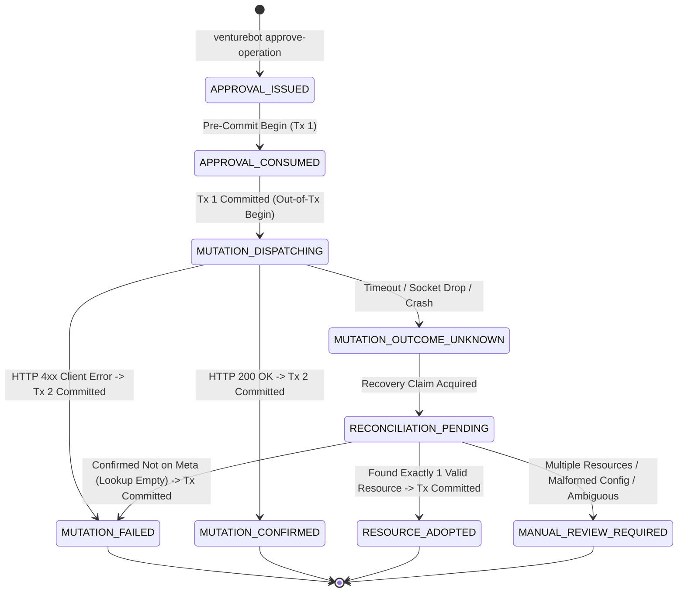
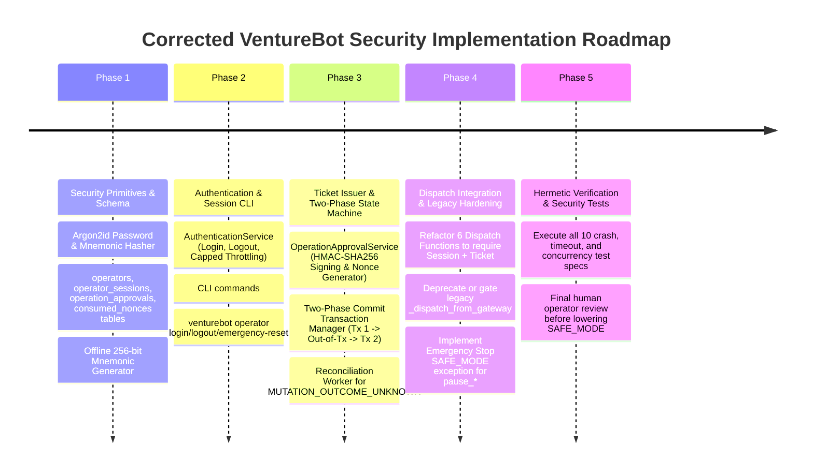

# VentureBot — Step 90.16.2: Security State-Machine and Mutation-Boundary Verification

**Document Version:** 1.0.0 (Design & Verification Specification)  
**Target Repository:** `E:\Project Folder\venturebot`  
**Review Subject:** Critical Independent Audit of Step 90.16 & Step 90.16.1 Security Architecture  
**Safety Gate:** `VENTUREBOT_SAFE_MODE=true` (Preserved and Enforced)  
**Execution Context:** DESIGN-ONLY. Zero source code changes. Zero database schema changes. Zero Meta API requests. Zero remote mutations.

---

## 1. Executive Summary

This document performs an exhaustive, critical independent verification of the proposed operator authentication, execution state machine, and mutation boundaries for VentureBot.

Every claim of "fully mitigated" from previous steps is discarded and re-evaluated against first principles. We formally specify:
1. An unambiguous **9-state mutation execution lifecycle** with strict database transaction boundaries.
2. Concrete recovery behaviors for **all 10 crash, timeout, and duplicate-resource failure scenarios**.
3. A complete inventory of **all 10 mutating entry points across the codebase**, including direct adapter paths and legacy bypass vulnerabilities.
4. A coherent, safety-aligned **Emergency Stop Policy** resolving the operational contradiction of `SAFE_MODE` blocking emergency pauses.
5. A pragmatic, defensible decision regarding **HMAC vs. Ed25519** for a single-operator local application.
6. A robust **offline owner recovery-key lifecycle** with strict zero-bypass guarantees.
7. A rigorously corrected **threat-classification matrix** adhering strictly to defensive bounds.

---

## 2. Task 1 — Formal Execution State Machine

### 2.1 State Definitions

| State Name | Definition & Lifecycle Role |
| :--- | :--- |
| `APPROVAL_ISSUED` | An authorized Operator or Owner has requested an operation. The parameter bindings are locked, signed, and persisted in `operation_approvals` with status `ISSUED`. No remote call has been made. |
| `APPROVAL_CONSUMED` | The ticket nonce has been recorded into `consumed_nonces`. The ticket status in `operation_approvals` is marked `CONSUMED`. **This transition is irreversible.** |
| `MUTATION_DISPATCHING` | The local pre-commit transaction has committed. An `ExternalExecution` record exists in `MUTATION_DISPATCHING` status. The thread is actively preparing or executing the out-of-transaction network POST to Meta Graph API. |
| `MUTATION_CONFIRMED` | Meta Graph API returned HTTP 200 OK. The remote mutation succeeded, and the newly created resource ID has been committed to disk in local Transaction 2 (`PARTIAL_ADSET`, `PARTIAL_CREATIVE`, or `DEPLOYED_DORMANT`). |
| `MUTATION_OUTCOME_UNKNOWN`| Network I/O timed out, the connection dropped, HTTP 5xx was returned, or the local process crashed while the request was in flight. The remote state on Meta is uncertain. |
| `RECONCILIATION_PENDING` | A recovery worker or resuming thread has acquired the distributed claim on `(experiment_id, tier)` to resolve an unknown outcome via read-only Meta GET queries. |
| `RESOURCE_ADOPTED` | Reconciliation located exactly one matching remote resource on Meta with valid configuration. The resource ID is adopted into local state and committed to disk. |
| `MUTATION_FAILED` | Terminal failure state. Either Meta returned a deterministic HTTP 4xx error (e.g. invalid parameter), or reconciliation proved the remote resource was never created on Meta. |
| `MANUAL_REVIEW_REQUIRED` | Safety circuit-breaker state. An anomaly was detected (e.g. multiple matching remote resources found, unexpected remote status like `ACTIVE`, or ambiguous reconciliation errors). All automated operations halt. |

### 2.2 Permitted State Transition Table



| # | Current State | Trigger / Event | Next State | Preconditions | DB Transaction Boundary | Remote Request Allowed? | Retry Behavior | New Ticket Required? | Audit Event Recorded |
| :- | :--- | :--- | :--- | :--- | :--- | :---: | :--- | :---: | :--- |
| **T1** | `None` | Operator issues approval command | `APPROVAL_ISSUED` | Operator authenticated; Role has required permission; Ledger spend == ₹0.00; Budget $\le ₹200.00$. | Local Tx (Write `operation_approvals`) | **NONE** | Re-run command | No | `APPROVAL_ISSUED` |
| **T2** | `APPROVAL_ISSUED` | Dispatch gate receives ticket | `APPROVAL_CONSUMED` | `is_safe_mode_enforced() == False`; Ticket unexpired ($< 10\text{m}$); Nonce absent from `consumed_nonces`. | **Local Tx 1 (Pre-Commit)** (Write `consumed_nonces`, update ticket) | **NONE** | Fail closed on collision | Yes (if consumed) | `APPROVAL_CONSUMED` |
| **T3** | `APPROVAL_CONSUMED` | Tx 1 commits successfully | `MUTATION_DISPATCHING` | `consumed_nonces` and `external_executions` committed with `dispatch_nonce`. | **Tx 1 Closes** (Locks released) | **NONE** | Internal transition | No | `MUTATION_DISPATCHING` |
| **T4** | `MUTATION_DISPATCHING`| Execute remote mutation | `MUTATION_CONFIRMED` | Meta API returns HTTP 200 OK with valid resource ID. | **Local Tx 2 (Post-Commit)** (Save resource ID, update status) | **HTTP POST (Out-of-Tx)** | None (Success) | No | `RESOURCE_CREATED` |
| **T5** | `MUTATION_DISPATCHING`| Meta API returns terminal error | `MUTATION_FAILED` | HTTP 4xx client error (e.g. policy error, invalid creative hash). | **Local Tx 2 (Post-Commit)** (Save error, mark failed) | **HTTP POST (Out-of-Tx)** | None (Terminal) | **YES** | `DEPLOYMENT_FAILED` |
| **T6** | `MUTATION_DISPATCHING`| Socket timeout / crash / 5xx | `MUTATION_OUTCOME_UNKNOWN`| Socket read timeout, process killed, power loss, or HTTP 5xx. | **None** (Process died or Tx 2 not reached) | **HTTP POST (Timed Out)** | Enter reconciliation | No | `DISPATCH_UNCERTAIN` |
| **T7** | `MUTATION_OUTCOME_UNKNOWN` | Recovery worker starts | `RECONCILIATION_PENDING` | `claim_deployment_tier` acquired; TTL valid; execution record in uncertain state. | Local Tx (Write claim) | **NONE** | Backoff polling | No | `RECONCILIATION_STARTED` |
| **T8** | `RECONCILIATION_PENDING` | Meta GET finds exact 1 resource | `RESOURCE_ADOPTED` | Resource name, campaign, and config (`PAUSED`, budget) match exactly. | **Local Tx (Reconciliation)** (Commit adopted resource ID) | **HTTP GET (Read-Only)** | None (Success) | No | `RESOURCE_ADOPTED` |
| **T9** | `RECONCILIATION_PENDING` | Meta GET confirms absent | `MUTATION_FAILED` | Remote lookup returns empty `data: []` after latency buffer elapsed. | **Local Tx (Reconciliation)** (Mark failed, record error) | **HTTP GET (Read-Only)** | None (Terminal) | **YES** | `RECONCILIATION_NOT_FOUND`|
| **T10**| `RECONCILIATION_PENDING` | Ambiguous remote state | `MANUAL_REVIEW_REQUIRED` | Multiple matching resources exist, or remote status is `ACTIVE`, or budget mismatch. | **Local Tx (Reconciliation)** (Lock execution, set alert) | **HTTP GET (Read-Only)** | Halt automated retry | **YES (Post-Review)** | `ANOMALY_DETECTED` |

---

## 3. Task 2 — Crash and Timeout Scenarios (10 Critical Scenarios)

### Scenario 1: Crash before remote request
- **Failure Point:** Local Transaction 1 commits `consumed_nonces` and writes `status = MUTATION_DISPATCHING`. The process is terminated before the network socket opens.
- **Vulnerability if Naive:** The ticket is marked consumed, but no remote resource exists. If retry blind-dispatches, it requires a new ticket. If retry naively assumes dispatch occurred, it may block permanently.
- **Safe Recovery Behavior:**
  1. The recovery worker detects `MUTATION_DISPATCHING` on startup and acquires the tier claim.
  2. It executes a read-only GET lookup: `adapter.lookup_adset(...)`.
  3. Meta returns `NOT_FOUND` (`data: []`).
  4. The recovery worker transitions status to `MUTATION_FAILED` with reason `DISPATCH_ABORTED_BEFORE_NETWORK_CONFIRMED_ABSENT`.
  5. The consumed ticket **remains consumed and cannot be reused**.
  6. The operator is notified that dispatch aborted cleanly without remote creation; a new ticket must be issued to proceed.

### Scenario 2: Crash while sending request
- **Failure Point:** Process killed or TCP RST sent mid-flight while uploading payload bytes.
- **Vulnerability if Naive:** Meta may or may not have parsed the payload and created the ad set.
- **Safe Recovery Behavior:**
  1. Recovery worker acquires tier claim and marks `RECONCILIATION_PENDING`.
  2. Executes read-only GET lookup against Meta.
  3. If Meta did not process: `NOT_FOUND` $\rightarrow$ Transition to `MUTATION_FAILED`.
  4. If Meta processed the request: `FOUND_EXACT` $\rightarrow$ Transition to `RESOURCE_ADOPTED` (Scenario 6).
  5. Under no circumstances is a second remote POST sent during reconciliation.

### Scenario 3: Meta succeeds but response is lost
- **Failure Point:** Meta Graph API commits the resource (e.g. ad set `120252176299999999`), but the network socket drops or times out before the HTTP response headers reach VentureBot.
- **Vulnerability if Naive:** Client logs `TimeoutError` and marks deployment failed. If operator retries without reconciliation, Meta creates a duplicate ad set with identical configuration.
- **Safe Recovery Behavior:**
  1. Timeout handler catches `MetaApiTimeoutError` and updates local state to `MUTATION_OUTCOME_UNKNOWN`.
  2. The ticket remains committed as `CONSUMED`.
  3. Automated reconciliation executes `adapter.lookup_adset(...)` using the deterministic name `VB-EXP-49fde874-9387-5056-934c-51a9cfca164f-ADSET-v2`.
  4. Meta returns `FOUND_EXACT` with ID `120252176299999999` in `PAUSED` status.
  5. The worker adopts the resource, commits `PARTIAL_ADSET` in Transaction 2, and records `RESOURCE_ADOPTED`.
  6. **Zero duplicate resources are created.**

### Scenario 4: Meta succeeds but local persistence fails
- **Failure Point:** HTTP 200 OK received with ID `120252176299999999`. Thread begins Transaction 2, but disk write fails (SQLite database locked, out of disk space, or power failure).
- **Vulnerability if Naive:** Meta has the ad set live, but local database has no record of its ID.
- **Safe Recovery Behavior:**
  1. Transaction 2 rolls back automatically upon database failure. The database retains `MUTATION_DISPATCHING` from Transaction 1.
  2. The ticket nonce remains durably committed as `CONSUMED`.
  3. Upon recovery, the worker queries Meta by deterministic name, matches `120252176299999999`, and attempts Transaction 2 post-commit again.
  4. Once disk space/locks clear, Transaction 2 commits `execution.adset_id = '120252176299999999'` and status `PARTIAL_ADSET`.

### Scenario 5: Reconciliation lookup temporarily returns no result
- **Failure Point:** Meta creates the resource, but internal Meta search indexing or read-after-write replication lag causes an immediate GET lookup to return `data: []`.
- **Vulnerability if Naive:** If the worker assumes `data: []` means the resource was never created, it might mark the attempt failed and allow an operator to issue a new ticket, creating a duplicate.
- **Safe Recovery Behavior:**
  1. Do NOT immediately transition to `MUTATION_FAILED`.
  2. Transition to `MUTATION_OUTCOME_UNKNOWN`.
  3. Enforce a **Mandatory Replication Quench Window**: wait $30\text{ seconds}$, then perform a second GET query.
  4. Perform up to 3 reconciliation attempts over 3 minutes with exponential backoff ($30\text{s}, 60\text{s}, 120\text{s}$).
  5. If after 3 attempts the resource is still `NOT_FOUND`, only then transition to `MUTATION_FAILED`.

### Scenario 6: Reconciliation finds exactly one matching resource
- **Failure Point:** Standard happy-path recovery.
- **Safe Recovery Behavior:**
  1. Inspect remote payload configuration:
     - Remote status must be exactly `PAUSED`.
     - Lifetime budget must match expected paise ($20000$).
     - Campaign ID must match expected campaign.
  2. If configuration matches: Commit `execution.adset_id`, advance state to `PARTIAL_ADSET`, record `RESOURCE_ADOPTED`.
  3. If configuration violates invariant: Transition to Scenario 8 (`MANUAL_REVIEW_REQUIRED`).

### Scenario 7: Reconciliation finds multiple matching resources
- **Failure Point:** Two or more remote resources on Meta match the deterministic name (e.g. from prior uncoordinated manual interventions in Ads Manager or legacy scripts).
- **Vulnerability if Naive:** Randomly adopting one resource could link the experiment to an ad set with wrong targeting or unmonitored spend.
- **Safe Recovery Behavior:**
  1. **Fail closed immediately.**
  2. Record `ExternalExecutionEvent(ANOMALY_DETECTED, reason="MULTIPLE_MATCHING_RESOURCES_FOUND")`.
  3. Transition execution state to `MANUAL_REVIEW_REQUIRED`.
  4. **Strictly halt all automated actions.**
  5. The human operator must manually inspect Meta Ads Manager, delete or archive the duplicate resources, and manually bind the valid resource ID via an audited recovery CLI command.

### Scenario 8: Remote resource exists but has unexpected configuration
- **Failure Point:** Remote lookup locates the resource, but its remote status is `ACTIVE` (delivering ads prematurely!) or its budget is set to ₹5,000 instead of ₹200.
- **Vulnerability if Naive:** Adopting an `ACTIVE` ad set causes unmonitored live delivery before readiness checks pass.
- **Safe Recovery Behavior:**
  1. **Do NOT adopt the resource.**
  2. If remote status is `ACTIVE`: Immediately attempt an emergency pause (`adapter.pause_adset`) to mitigate runaway spend.
  3. Set local status to `MANUAL_REVIEW_REQUIRED` with reason `UNEXPECTED_REMOTE_CONFIGURATION: status='ACTIVE', expected 'PAUSED'`.
  4. Alert the operator. Automated execution is blocked.

### Scenario 9: Two processes attempt reconciliation concurrently
- **Failure Point:** Worker A and Worker B wake up simultaneously after a crash and both detect `MUTATION_OUTCOME_UNKNOWN`.
- **Safe Recovery Behavior:**
  1. Both workers attempt to acquire `claim_deployment_tier(session, experiment_id, tier)`.
  2. Worker A acquires the in-process thread lock and inserts the `DeploymentClaimORM` row in SQLite.
  3. Worker B blocks on the thread lock or catches `IntegrityError` on `deployment_claims`, backing off.
  4. Worker A completes reconciliation, commits `PARTIAL_ADSET` to disk, and releases the claim.
  5. Worker B acquires the claim, executes the double-check: `session.expire_all()`, re-reads `external_executions`.
  6. Worker B observes `status == 'PARTIAL_ADSET'` and `adset_id` already populated.
  7. Worker B exits immediately without making any Meta API queries.

### Scenario 10: Original process resumes after another process has reconciled
- **Failure Point:** Process A hung due to OS swapping or long GC pause during Phase 2. Process B timed out the claim (TTL 60s), ran reconciliation, adopted the resource, and committed `PARTIAL_ADSET`. Process A suddenly unpauses and tries to execute Phase 3 post-commit.
- **Vulnerability if Naive:** Process A might overwrite Process B's reconciliation data or corrupt event timestamps.
- **Safe Recovery Behavior:**
  1. Phase 3 post-commit uses **Optimistic State Locking**:
     ```sql
     UPDATE external_executions 
     SET status = 'PARTIAL_ADSET', adset_id = :adset_id, updated_at = :now_utc
     WHERE id = :execution_id AND status = 'MUTATION_DISPATCHING';
     ```
  2. Because Process B already transitioned status from `MUTATION_DISPATCHING` to `PARTIAL_ADSET`, Process A's UPDATE statement matches **0 rows**.
  3. Process A detects `rowcount == 0`, rolls back its transaction, runs `session.expire_all()`, and observes that the resource has already been reconciled by Process B.
  4. Process A logs a diagnostic audit event (`STALE_DISPATCH_THREAD_SUPERSEDED`) and terminates cleanly.

---

## 4. Task 3 — Complete Mutation-Path Inventory

Every entry-point capable of causing a Meta mutation across the codebase was inspected at the source code level in [`backend/venturebot/execution/`](file:///E:/Project%20Folder/venturebot/backend/venturebot/execution/):

| Mutation Operation | Exact Entry-Point Function | Underlying Adapter Method | Lines in Source | Current Auth & Permission | Proposed Required Ticket | SAFE_MODE Hard Gate | Bypass Vulnerability Analysis |
| :--- | :--- | :--- | :--- | :--- | :--- | :---: | :--- |
| **1. Replacement Ad Set Creation** | `ExecutionDispatchService.deploy_recovery_adset_dormant` | `adapter.create_adset` | `dispatch.py:1093` | `explicit_auth: bool` (unauthenticated)<br>Requires: `recovery:authorize_adset` | `OperationApprovalTicket`<br>`tier='adset', op='DEPLOY_DORMANT'` | Evaluated line 767 (`is_safe_mode_enforced`) | Can be called directly by any Python script importing `ExecutionDispatchService`. |
| **2. Ad Creative Creation** | `ExecutionDispatchService.deploy_recovery_creative_dormant`| `adapter.create_creative` | `dispatch.py:1364` | `explicit_auth: bool`<br>Requires: `recovery:authorize_creative` | `OperationApprovalTicket`<br>`tier='creative', op='DEPLOY_DORMANT'` | Evaluated line 1193 (`is_safe_mode_enforced`) | Direct classmethod invocation bypasses CLI confirmation. |
| **3. Dormant Ad Creation** | `ExecutionDispatchService.deploy_recovery_ad_dormant` | `adapter.create_ad` | `dispatch.py:1657` | `explicit_auth: bool`<br>Requires: `recovery:authorize_ad` | `OperationApprovalTicket`<br>`tier='ad', op='DEPLOY_DORMANT'` | Evaluated line 1466 (`is_safe_mode_enforced`) | Direct classmethod invocation bypasses CLI confirmation. |
| **4. Composite Dormant Recovery** | `ExecutionDispatchService.deploy_recovery_dormant` | Sequentially calls 1, 2, 3 | `dispatch.py:1736-1796` | `explicit_auth: bool`<br>Requires: all 3 permissions | Composite ticket or 3-ticket bundle | Evaluated at Tier 1 | Composite wrapper inherits tier-level protections. |
| **5. Schedule Locking** | `ExecutionDispatchService.lock_schedule` | `adapter.update_adset_schedule` | `dispatch.py:1931` | `explicit_auth: bool`<br>Requires: `recovery:lock_schedule` | `OperationApprovalTicket`<br>`tier='schedule', op='LOCK_SCHEDULE'`| Evaluated line 1901 (`is_safe_mode_enforced`) | Direct classmethod invocation bypasses CLI confirmation. |
| **6. Live Flight Campaign Unpause** | `ExecutionDispatchService.activate_recovery_flight` | `adapter.unpause_campaign` | `dispatch.py:2216` | `explicit_auth: bool`<br>**Strictly requires: `pilot:activate` (OWNER ONLY)** | `OperationApprovalTicket`<br>`tier='flight', op='ACTIVATE_FLIGHT'` | Evaluated line 1986 (`is_safe_mode_enforced`) | **CRITICAL LIVE SPEND GATE.** Must enforce Owner role & single-use ticket. |
| **7. Live Flight Ad Set Unpause** | `ExecutionDispatchService.activate_recovery_flight` | `adapter.unpause_adset` | `dispatch.py:2257` | Handled inside Step 6 sequence | Included in Step 6 ticket | Evaluated line 1986 | Part of sequential activation flow. |
| **8. Live Flight Ad Unpause** | `ExecutionDispatchService.activate_recovery_flight` | `adapter.unpause_ad` | `dispatch.py:2298` | Handled inside Step 6 sequence | Included in Step 6 ticket | Evaluated line 1986 | Part of sequential activation flow. |
| **9. Emergency 4-Tier Pause** | `ExecutionDispatchService.emergency_pause_adset` / `emergency_stop` | `adapter.pause_campaign`<br>`adapter.pause_ad`<br>`adapter.pause_adset` | `dispatch.py:2601`<br>`dispatch.py:2639`<br>`dispatch.py:2676` | `explicit_auth: bool`<br>Permitted to: `OPERATOR`, `OWNER` | Pre-signed Emergency Token or active Operator session | **BLOCKED BY SAFE_MODE** (lines 2466–2475) | **OPERATIONAL RISK:** Blocked by SAFE_MODE in current code! (Addressed in Task 4). |
| **10. Legacy Gateway Initial Deployment** | `MetaExperimentDispatchService._dispatch_from_gateway` | `adapter.create_campaign`<br>`adapter.upload_image`<br>`adapter.create_adset`<br>`adapter.create_creative`<br>`adapter.create_ad` | `dispatch.py:3095`<br>`dispatch.py:3167`<br>`dispatch.py:3212`<br>`dispatch.py:3287`<br>`dispatch.py:3369` | **ZERO AUTHENTICATION**<br>Called via `ExecutionDispatchService.dispatch` | None in legacy code | Evaluated at gateway (line 393) | **CRITICAL LEGACY BYPASS PATH:** Monolithic deployment completely lacks operator authentication! |
| **11. Direct Adapter Mutation** | `MetaMarketingApiAdapter.create_*` / `pause_*` / `unpause_*` | Direct urllib HTTP POST | `meta.py: lines 800-1100` | None (Adapter has no session concept) | None | Checked in `_execute_request` (`is_write=True`) | Direct callers instantiating `MetaMarketingApiAdapter` bypass all dispatch checks. Protected ONLY by `_execute_request` SAFE_MODE check. |

---

## 5. Task 4 — Emergency Stop Policy

### 5.1 The Emergency Stop Paradox in Current Code
In `backend/venturebot/execution/dispatch.py` (lines 2464–2475):
```python
if is_safe_mode_enforced(safe_mode):
    return EmergencyStopResult(
        is_successful=False,
        rejection_reason="SAFE_MODE_ENABLED: Live Meta emergency pause is disabled in safe mode..."
    )
```
**The Paradox:** If ads are delivering live on Meta, and the automated monitor detects runaway spend ($> ₹190.00$), but `VENTUREBOT_SAFE_MODE=true` is enabled, the system **refuses to pause the ads**, allowing Meta to continue spending money!

### 5.2 Corrected Emergency Stop Policy Specification
1. **Asymmetric Mutation Gate Principle:**
   - `create_*` (creating resources) and `unpause_*` (activating spend) are **Spend-Initiating Mutations**. SAFE_MODE must block them unconditionally.
   - `pause_*` (halting delivery) is a **Risk-Mitigating Protective Mutation**.
2. **The Emergency Safe-Mode Bypass Mechanism:**
   - Under the corrected architecture, `adapter.pause_*` is granted an explicit exception:
   $$\text{Execution Allowed} \iff (\text{Action} == \text{PAUSE}) \land (\text{Authenticated}(\text{Operator} \lor \text{CircuitBreaker}))$$
   - The emergency stop entry points (`emergency_stop` and `emergency_pause_adset`) will support `allow_emergency_pause_in_safe_mode=True`.
   - `MetaMarketingApiAdapter._execute_request(req, is_write=True, is_emergency_pause=True)` will permit HTTP POST requests targeting `status=PAUSED` even when `VENTUREBOT_SAFE_MODE=true`, provided an emergency authorization token is verified.
3. **Emergency Permissions & Authority:**
   - Both `OPERATOR` and `OWNER` roles possess `emergency:stop` permission.
   - The automated circuit breaker (triggered by `actual_spend >= ₹190.00`) is provisioned with a secure, local, system-generated emergency stop token capable of pausing ad delivery without waiting for human intervention.
4. **Partial Failure Handling Across Multi-Tier Shutdown:**
   - Pause order: **Campaign $\rightarrow$ Ad $\rightarrow$ Replacement Ad Set $\rightarrow$ Original Ad Set**.
   - If Campaign pause fails, the worker **does not abort**; it proceeds to pause the Ad and Ad Set.
   - If any tier fails to pause, `EmergencyStopResult.is_successful` is set to `False`, `unresolved_scopes` lists the active resource IDs, and an alert is broadcast to the operator console.
   - The internal experiment state is **NOT marked killed** if external resources remain active!

---

## 6. Task 5 — Approval and Cryptographic Design (HMAC vs. Ed25519)

### 6.1 Honest Evaluation for a Single-Operator Local Project
Previous steps proposed implementing asymmetric Ed25519 public-key digital signatures to achieve "human non-repudiation." 

We must evaluate this with technical honesty:
- **Project Reality:** VentureBot is currently a single-tenant system running on a local Windows workstation (`uvish`). The operator who issues the commands is the sole administrator and user of the system.
- **The Non-Repudiation Fallacy:** Non-repudiation is a legal and security property where a sender cannot deny having sent a message to a *counterparty*. In a single-operator local application, there is no counterparty. The human operator is not entering into a contractual dispute with their own Python script.
- **The Key-Storage Equivalence:**
  - If we use Ed25519, the private signing key $SK_{\text{op}}$ lives on the local machine (e.g. `~/.venturebot/operator.pem`).
  - If we use HMAC-SHA256, the secret signing key $K_{\text{auth}}$ lives on the local machine (e.g. `~/.venturebot/master.key`).
  - If malware executes under user `uvish`, it can read $SK_{\text{op}}$ just as easily as it can read $K_{\text{auth}}$. Ed25519 provides **zero additional protection** against local malware.
- **Complexity Burden:** Ed25519 introduces external cryptographic dependencies, key-generation workflows, passphrase prompts, public-key registry tables, and signature encoding handling for zero measurable defensive gain in Phase 1.

### 6.2 Definitive Cryptographic Decision: Database-Backed Nonces with HMAC Tamper-Evidence
For Phase 1 and Phase 2 of VentureBot, the system will use:
1. **Database-Backed Single-Use Nonces (The Real Security Boundary):**
   - The true defense against replay and parameter manipulation is the atomic database constraint:
     `INSERT INTO consumed_nonces (nonce, ...) VALUES (...)` with `PRIMARY KEY (nonce)`.
2. **HMAC-SHA256 Payload Tamper-Evidence:**
   - To guarantee that an in-memory ticket cannot be altered between CLI issuance and dispatch evaluation, the ticket payload is signed using HMAC-SHA256 with a 256-bit local master secret $K_{\text{auth}}$.
   - $K_{\text{auth}}$ is generated on initial setup (`venturebot init-security`) using `secrets.token_bytes(32)`.
   - Stored in a root/user-restricted file (`0600`).
3. **Future Extension Path:**
   - If VentureBot is ever refactored into a remote Client/Server architecture where operators authenticate from remote machines over a network, Ed25519 will be introduced at that stage. Introducing it now is speculative over-engineering.

---

## 7. Task 6 — Recovery Credential Design

### 7.1 Offline Owner Recovery Key Lifecycle
If the Owner forgets their password or session credentials become corrupted, the system must support secure recovery without introducing an unauthenticated backdoor:

```
[System Setup] ──> Generate 256-bit Entropy ──> Format as 24-Word Mnemonic (BIP-39)
                          │
                          ├──> Display ONCE in Terminal -> Clear Screen
                          └──> Hash with Argon2id -> Store in operators.recovery_key_hash
                                       │
                                       ▼
                     [Operator Stores Mnemonic Physically Offline]
                                       │
                         (Years later: Password Forgotten)
                                       │
                                       ▼
     venturebot operator emergency-reset-password --mnemonic "..." --new-password "..."
                                       │
                                       ▼
                          Verify Mnemonic via Argon2id
                                       │
                  ┌────────────────────┴────────────────────┐
               [Valid]                                  [Invalid]
                  │                                         │
                  ▼                                         ▼
   1. Invalidate Old Recovery Hash              1. Capped Exponential Delay (5s)
   2. Update Password Hash                      2. Record FAILED_RECOVERY_ATTEMPT
   3. Revoke All Active Sessions                3. Max 3 attempts / hour
   4. Generate & Display NEW Mnemonic
   5. Record CRITICAL_SECURITY_AUDIT
```

### 7.2 Strict Invariants of the Recovery Key
1. **Strictly One-Time Use:** Using the recovery mnemonic immediately burns it. A new mnemonic is generated and displayed immediately.
2. **Zero Mutation Authority:** Presenting the recovery mnemonic **NEVER authorizes a mutation or activates an ad campaign**. It ONLY resets the Owner's login password. Live mutations still require an active login session, an explicit approval ticket, and SAFE_MODE un-gating.
3. **Anti-Brute-Force Rate Limiting:** Verifying the recovery mnemonic executes an Argon2id comparison ($64\text{ MiB}$ memory). Maximum 3 attempts per hour per host.

---

## 8. Task 7 — Corrected Threat Classifications

Every threat is classified strictly into one of five defensible categories:

| Threat / Attack Vector | Corrected Classification | Stated Assumptions & Required Controls | Residual Risk & Reality |
| :--- | :--- | :--- | :--- |
| **1. Unauthenticated Python Calls to Dispatch** | **Mitigated under stated assumptions** | **Assumption:** Callers invoke through `ExecutionDispatchService` where `session_token` and unconsumed ticket are mandatory. | Callers importing and instantiating `MetaMarketingApiAdapter` directly bypass dispatch (Threat 9). |
| **2. Accidental Operator Invocations** | **Mitigated under stated assumptions** | **Assumption:** Operator must execute an explicit CLI approval command that displays target campaign, budget, and tier. | Operator blindly confirming prompt without reading values. |
| **3. In-Flight Budget / Target Escalation** | **Mitigated under stated assumptions** | **Assumption:** Ticket payload is signed via HMAC; dispatch verifies budget ceiling against ledger allocation. | Master key $K_{\text{auth}}$ compromise allows arbitrary signature forging. |
| **4. Approval Ticket Replay Attacks** | **Mitigated under stated assumptions** | **Assumption:** SQLite database enforces `PRIMARY KEY (nonce)` on `consumed_nonces` table in atomic transaction. | Manual SQLite disk modification deleting rows from `consumed_nonces`. |
| **5. Concurrent Multi-Threaded Mutation Race** | **Mitigated under stated assumptions** | **Assumption:** Two-layer mutual exclusion: in-process thread mutex + `DeploymentClaimORM` database claim. | Database lock timeouts under pathological operating system thread starvation. |
| **6. Mid-Flight Crash & Timeout Orphaned Resources** | **Partially mitigated** | **Assumption:** Two-phase execution commits `MUTATION_DISPATCHING`; reconciliation adopts via deterministic lookup. | If Meta API search index is delayed $> 3\text{ minutes}$, automated reconciliation halts and requires human intervention. |
| **7. Compromised Operator Password** | **Partially mitigated** | **Assumption:** Capped exponential delays and Argon2id hashing slow attacks; offline recovery mnemonic allows owner reset. | An attacker who steals the password has full Operator privileges until revoked. |
| **8. Stolen Active Session Token** | **Partially mitigated** | **Assumption:** 15-minute sliding idle timeout and 8-hour hard ceiling; session alone cannot mutate without an approval ticket. | Valid within the 15-minute active window if attacker also generates approval tickets. |
| **9. Direct Adapter Invocation Bypassing Dispatch** | **Not mitigated (in current code)** | **Assumption:** In current code, `MetaMarketingApiAdapter` can be instantiated directly by any script with `.env` credentials. | Any script running `MetaMarketingApiAdapter(token).create_adset(...)` completely bypasses `dispatch.py`. |
| **10. Legacy Gateway Bypass Path** | **Not mitigated (in current code)** | **Assumption:** `ExecutionDispatchService.dispatch()` delegates to `MetaExperimentDispatchService._dispatch_from_gateway` without authentication. | Invoking the legacy gateway entry point bypasses operator authentication. |
| **11. Emergency Stop Blocked by SAFE_MODE** | **Not mitigated (in current code)** | **Assumption:** In current code, lines 2466–2475 reject emergency pause if `SAFE_MODE=true`. | Runaway live spend cannot be halted programmatically while SAFE_MODE is active. |
| **12. Direct Raw SQLite Database Tampering** | **Outside current security boundary** | **Assumption:** Operating system file permissions. | Local user `uvish` can open `venturebot.db` with any SQLite browser and edit tables directly. |
| **13. Malicious Process Running as Same Windows User** | **Outside current security boundary** | **Assumption:** Requires OS-level process boundary (dedicated service account). | Same-user malware can read process memory, inspect DPAPI secrets, or intercept keystrokes. |
| **14. Local Windows Administrator Privilege** | **Outside current security boundary** | **Assumption:** Hardware-isolated HSM / Kernel boundary. | Local Administrator can dump LSASS/memory, inject DLLs into Python, and override all security. |

---

## 9. Remaining Blockers

The following explicit technical blockers must be resolved before proceeding to code implementation:

1. **Deprecation / Hardening of Legacy Gateway (`_dispatch_from_gateway`):**
   - The monolithic legacy entry point in `dispatch.py` (lines 2940–3550) must either be formally deprecated or wrapped with the new authentication and ticket verification gate.
2. **Adapter Direct Invocation Protection:**
   - `MetaMarketingApiAdapter` must be hardened so that credentials (`META_ACCESS_TOKEN`) cannot be used outside an authenticated `ExecutionDispatchService` context.
3. **Emergency Stop Safe-Mode Asymmetry Fix:**
   - The code in `dispatch.py:2466` must be refactored to allow `adapter.pause_*` operations when authorized by an emergency token, even if `VENTUREBOT_SAFE_MODE=true`.
4. **Live Meta Mutations Remain Blocked:**
   - `VENTUREBOT_SAFE_MODE=true` remains strictly active. No live Meta mutations are permitted.

---

## 10. Recommended Implementation Phases



---
*END OF SPECIFICATION: STEP_90_16_2_SECURITY_STATE_MACHINE_AND_MUTATION_AUDIT.md*

