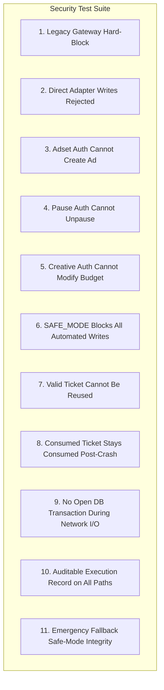

# VentureBot — Step 90.16.3: Mutation Boundary and Legacy Gateway Remediation Plan

**Document Version:** 1.0.0 (Design-Only Remediation Plan)  
**Target Repository:** `E:\Project Folder\venturebot`  
**Safety Gate:** `VENTUREBOT_SAFE_MODE=true` (Strictly Enforced)  
**Execution Context:** DESIGN-ONLY. Zero source code changes. Zero database schema modifications. Zero Meta API requests. Zero remote mutations.

---

## 1. Executive Summary & Approved Decisions

Following the critical audits in Step 90.16.1 and Step 90.16.2, this document establishes the concrete, implementation-ready remediation plan to harden VentureBot's mutation boundary and eliminate legacy dispatch vulnerabilities.

### 1.1 Core Approved Policy Decisions
1. **Hard Deprecation of Legacy Gateway:** `MetaExperimentDispatchService._dispatch_from_gateway` is formally deprecated and will be hard-blocked. It will not remain an alternate route to Meta mutations.
2. **Absolute SAFE_MODE Enforcement (Including Emergency Pause):** `VENTUREBOT_SAFE_MODE=true` blocks all automated Meta mutations unconditionally, including `pause_*` operations. For the current pilot, manual intervention via Meta Ads Manager is the approved emergency fallback.
3. **No Automatic SAFE_MODE Bypass:** No automatic circuit breaker, background cron, or pre-provisioned token may bypass SAFE_MODE.
4. **No Live Activation / Spending Authorized:** Live Meta ad flights and advertising expenditure remain strictly unauthorized.
5. **Defense-in-Depth Adapter Enforcement:** Direct adapter invocation must be restricted via a single-use `MutationCapability` object.
6. **Operating System Boundary Honesty:** Malicious same-user Windows processes and local administrator compromises are formally recognized as outside the application's software security boundary.

---

## 2. Task 1 — Legacy Gateway Dependency & Remediation Map

### 2.1 Complete Call Tree & Dependency Analysis

An exhaustive search across `backend/` and `tests/` revealed the exact dependency topology of the legacy gateway:

```
[External Invocation / Test]
       │
       ▼
ExecutionDispatchService.dispatch(request, ...)  [dispatch.py:373]
       │
       ├── Line 393: Evaluates is_safe_mode_enforced(safe_mode)
       ├── Lines 402-450: Guardrails (APPROVED status, positive budget, action check)
       │
       └── Line 536: Delegates composite DEPLOY_EXPERIMENT
             │
             ▼
MetaExperimentDispatchService._dispatch_from_gateway(..., gateway_context)  [dispatch.py:2917]
       │
       ├── Line 3095: adapter.create_campaign(...)
       ├── Line 3167: adapter.upload_image(...)
       ├── Line 3212: adapter.create_adset(...)
       ├── Line 3287: adapter.create_creative(...)
       └── Line 3369: adapter.create_ad(...)
```

#### Detailed Caller Inventory

| Component | File & Line | Call Context | Purpose / Workflow |
| :--- | :--- | :--- | :--- |
| **Direct Backend Caller** | `backend/venturebot/execution/dispatch.py:536` | Inside `ExecutionDispatchService.dispatch()` | The sole call site in `backend/` that invokes `_dispatch_from_gateway`. |
| **Indirect Backend Caller** | None | None | **Zero** background tasks, API routes, or CLI commands in `backend/` call `ExecutionDispatchService.dispatch`. |
| **Test Suite Callers** | `tests/test_execution_dispatch.py` (18 calls) | Unit tests | Tests generic guardrails: unapproved experiments, excess budget, granular action rejections, SAFE_MODE gating, and legacy dispatch execution. |
| **Test Suite Callers** | `tests/test_pilot_persistence.py` (4 calls) | Integration tests | Verifies execution persistence, ledger spend tracking, and decision history during legacy dispatch. |
| **Test Suite Callers** | `tests/test_meta_reconciliation.py` (1 call) | Integration test | Helper fixture invoking legacy dispatch to seed execution records. |
| **Test Suite Callers** | `tests/test_safe_mode_boundary.py` (1 call) | Safety boundary test | Tests that `safe_mode=True` blocks `ExecutionDispatchService.dispatch`. |
| **Legacy Emergency Caller**| `backend/venturebot/execution/dispatch.py:649` | Inside `ExecutionDispatchService.emergency_stop()` | Calls `MetaExperimentDispatchService._emergency_stop` for legacy `STANDARD` lineage. |

### 2.2 Functional Impact of Deprecation
- **Production Impact:** **ZERO.** No production business logic or CLI command uses `_dispatch_from_gateway`. All active pilot operations have migrated to the granular Option B recovery deployment tiers (`deploy_recovery_adset_dormant`, `deploy_recovery_creative_dormant`, `deploy_recovery_ad_dormant`).
- **Test Suite Impact:** 24 unit and integration tests currently call `ExecutionDispatchService.dispatch()`. These tests must be refactored during implementation to verify the deprecation fail-closed block or migrate to testing granular recovery dispatches.

### 2.3 Fail-Closed Migration Plan
1. **Immediate Hard-Block in `MetaExperimentDispatchService._dispatch_from_gateway`:**
   ```python
   # In MetaExperimentDispatchService._dispatch_from_gateway (dispatch.py:2917)
   raise DeprecatedGatewayError(
       "LEGACY_GATEWAY_BLOCKED: MetaExperimentDispatchService._dispatch_from_gateway is deprecated "
       "and permanently blocked. Initial deployments must use granular, authenticated recovery tiers."
   )
   ```
2. **Immediate Rejection in `ExecutionDispatchService.dispatch`:**
   In `dispatch.py:536`, replace the delegation to `_dispatch_from_gateway` with:
   ```python
   return ExecutionDispatchResult(
       success=False,
       blocked=True,
       reason="LEGACY_DISPATCH_DEPRECATED: Monolithic deployment via dispatch() is permanently disabled.",
       action_attempted=request.requested_action,
       experiment_id=request.experiment_id,
   )
   ```
3. **Legacy Emergency Stop Removal:**
   In `ExecutionDispatchService.emergency_stop` (line 649), remove the fallthrough to `MetaExperimentDispatchService._emergency_stop`, routing all experiments through the audited 4-tier emergency stop with multi-factor ownership verification.

---

## 3. Task 2 — Complete Mutation Boundary Architecture

### 3.1 Exhaustive Inventory of Meta Mutations & Enforcement Matrix

Every Meta mutation across the codebase must be protected by an unambiguous, multi-layered validation stack:

```
[Call Invocations]
       │
       ▼
Layer 1: Global Environment & Parameter SAFE_MODE Gate
       ▼
Layer 2: Operator Identity Authentication (Argon2id Session Token)
       ▼
Layer 3: Role-Based Access Control (RBAC Permissions)
       ▼
Layer 4: OperationApprovalTicket Cryptographic & Binding Verification
       ▼
Layer 5: Financial Ledger & Experiment Invariants (Spend == ₹0.00, Budget <= ₹200.00)
       ▼
Layer 6: Distributed Concurrency Lock (claim_deployment_tier)
       ▼
Layer 7: Pre-Commit State Logging (consumed_nonces + MUTATION_DISPATCHING)
       ▼
Layer 8: Adapter Capability Enforcement (MutationCapability Verification)
       ▼
[Out-of-Transaction Remote HTTP Network POST to Meta]
       ▼
Layer 9: Post-Commit State Logging (MUTATION_CONFIRMED / MUTATION_FAILED)
```

### 3.2 Enforcement Responsibility by Layer

| Mutation Operation | Underlying Adapter Call | Layer 1: SAFE_MODE | Layer 2: AuthN (Session) | Layer 3: RBAC Permission | Layer 4: Approval Ticket | Layer 5: Ledger Invariants | Layer 6: Capability Required | Layer 7: Audit Event |
| :--- | :--- | :---: | :---: | :---: | :---: | :---: | :---: | :---: |
| **Create Campaign** | `adapter.create_campaign` | **BLOCKED** | Operator / Owner | `campaign:create` | `OP_CREATE_CAMPAIGN` | Spend == ₹0, Budget $\le ₹200$ | `Capability(CREATE_CAMPAIGN)` | `RESOURCE_CREATED` |
| **Upload Image** | `adapter.upload_image` | **BLOCKED** | Operator / Owner | `creative:upload` | `OP_UPLOAD_IMAGE` | Spend == ₹0 | `Capability(UPLOAD_IMAGE)` | `IMAGE_UPLOADED` |
| **Create Ad Set** | `adapter.create_adset` | **BLOCKED** | Operator / Owner | `recovery:authorize_adset` | `OP_DEPLOY_ADSET` | Spend == ₹0, Budget $\le ₹200$ | `Capability(CREATE_ADSET)` | `RESOURCE_CREATED` |
| **Create Creative** | `adapter.create_creative` | **BLOCKED** | Operator / Owner | `recovery:authorize_creative`| `OP_DEPLOY_CREATIVE` | Spend == ₹0 | `Capability(CREATE_CREATIVE)` | `RESOURCE_CREATED` |
| **Create Ad** | `adapter.create_ad` | **BLOCKED** | Operator / Owner | `recovery:authorize_ad` | `OP_DEPLOY_AD` | Spend == ₹0 | `Capability(CREATE_AD)` | `RESOURCE_CREATED` |
| **Update Schedule** | `adapter.update_adset_schedule`| **BLOCKED** | Operator / Owner | `recovery:lock_schedule` | `OP_LOCK_SCHEDULE` | Spend == ₹0, Duration == 48h | `Capability(UPDATE_SCHEDULE)` | `SCHEDULE_LOCKED` |
| **Unpause Campaign**| `adapter.unpause_campaign` | **BLOCKED** | **OWNER ONLY** | **`pilot:activate`** | `OP_ACTIVATE_FLIGHT` | Spend == ₹0, Approved | `Capability(UNPAUSE_CAMPAIGN)`| `ACTIVATED` |
| **Unpause Ad Set** | `adapter.unpause_adset` | **BLOCKED** | **OWNER ONLY** | **`pilot:activate`** | `OP_ACTIVATE_FLIGHT` | Spend == ₹0, Approved | `Capability(UNPAUSE_ADSET)` | `ACTIVATED` |
| **Unpause Ad** | `adapter.unpause_ad` | **BLOCKED** | **OWNER ONLY** | **`pilot:activate`** | `OP_ACTIVATE_FLIGHT` | Spend == ₹0, Approved | `Capability(UNPAUSE_AD)` | `ACTIVATED` |
| **Pause Campaign** | `adapter.pause_campaign` | **BLOCKED** (Current)<br>Manual Ads Mgr | Operator / Owner | `emergency:stop` | Emergency Token / Manual | Any spend state | `Capability(PAUSE_CAMPAIGN)` | `EMERGENCY_STOP` |
| **Pause Ad Set** | `adapter.pause_adset` | **BLOCKED** (Current)<br>Manual Ads Mgr | Operator / Owner | `emergency:stop` | Emergency Token / Manual | Any spend state | `Capability(PAUSE_ADSET)` | `EMERGENCY_STOP` |
| **Pause Ad** | `adapter.pause_ad` | **BLOCKED** (Current)<br>Manual Ads Mgr | Operator / Owner | `emergency:stop` | Emergency Token / Manual | Any spend state | `Capability(PAUSE_AD)` | `EMERGENCY_STOP` |

---

## 4. Task 3 — Adapter-Level Capability Enforcement

### 4.1 The Mutation Capability Object Specification

To prevent direct callers from instantiating `MetaMarketingApiAdapter` and executing un-gated mutations, all adapter write methods will require a short-lived, single-use `MutationCapability` token:

```python
class MutationOperation(str, Enum):
    CREATE_CAMPAIGN = "create_campaign"
    UPLOAD_IMAGE = "upload_image"
    CREATE_ADSET = "create_adset"
    CREATE_CREATIVE = "create_creative"
    CREATE_AD = "create_ad"
    UPDATE_SCHEDULE = "update_schedule"
    UNPAUSE_CAMPAIGN = "unpause_campaign"
    UNPAUSE_ADSET = "unpause_adset"
    UNPAUSE_AD = "unpause_ad"
    PAUSE_CAMPAIGN = "pause_campaign"
    PAUSE_ADSET = "pause_adset"
    PAUSE_AD = "pause_ad"


class MutationCapability:
    """Narrowly scoped, single-use in-memory authorization token required by MetaMarketingApiAdapter.
    
    Invariants:
    1. Constructed ONLY by verified dispatch services after DB pre-commit.
    2. Locked to exact MutationOperation, experiment_id, target resource, and budget ceiling.
    3. Can only be consumed once; subsequent invocations fail closed.
    4. Evaluates SAFE_MODE before permitting payload transmission.
    5. A pause capability CANNOT execute an unpause or create operation.
    """
    def __init__(
        self,
        operation: MutationOperation,
        experiment_id: UUID,
        ticket_id: UUID,
        target_resource: str,
        budget_ceiling_paise: int | None = None,
        is_emergency: bool = False,
    ):
        self._operation = operation
        self._experiment_id = experiment_id
        self._ticket_id = ticket_id
        self._target_resource = target_resource
        self._budget_ceiling_paise = budget_ceiling_paise
        self._is_emergency = is_emergency
        self._is_consumed = False
        self._created_at = datetime.now(timezone.utc)

    def validate_and_consume(
        self,
        expected_operation: MutationOperation,
        target_resource: str,
        safe_mode: bool | None = None,
        budget_paise: int | None = None,
    ) -> None:
        if self._is_consumed:
            raise CapabilityAlreadyConsumedError("MUTATION_CAPABILITY_REUSED: Single-use capability already consumed.")

        # Hard SAFE_MODE check
        if is_safe_mode_enforced(safe_mode):
            raise MetaApiSafetyError("SAFE_MODE_ENABLED: Automated Meta mutation rejected by capability guard.")

        # Operation type match
        if self._operation != expected_operation:
            raise UnauthorizedCapabilityError(
                f"CAPABILITY_OPERATION_MISMATCH: Capability '{self._operation.value}' cannot execute '{expected_operation.value}'."
            )

        # Target resource match
        if self._target_resource != target_resource:
            raise UnauthorizedCapabilityError(
                f"CAPABILITY_RESOURCE_MISMATCH: Capability for '{self._target_resource}' cannot mutate '{target_resource}'."
            )

        # Budget ceiling match
        if budget_paise is not None and self._budget_ceiling_paise is not None:
            if budget_paise > self._budget_ceiling_paise:
                raise UnauthorizedCapabilityError(
                    f"CAPABILITY_BUDGET_EXCEEDED: Requested {budget_paise} paise exceeds capability ceiling {self._budget_ceiling_paise} paise."
                )

        # Immediate single-use consumption
        self._is_consumed = True
```

### 4.2 Adapter Integration Pattern
Every mutating method in [`MetaMarketingApiAdapter`](file:///E:/Project%20Folder/venturebot/backend/venturebot/execution/meta.py) will accept the capability as its first argument:
```python
def create_adset(
    self,
    capability: MutationCapability,
    campaign_id: str,
    name: str,
    lifetime_budget_paise: int,
    ...
) -> str:
    capability.validate_and_consume(
        expected_operation=MutationOperation.CREATE_ADSET,
        target_resource=campaign_id,
        budget_paise=lifetime_budget_paise,
    )
    # Proceed to HTTP POST via _execute_request(req, is_write=True)
```

### 4.3 Explicit Limitations of Python In-Process Security
We state the security boundaries of this mechanism with complete technical transparency:
- **What `MutationCapability` Solves:**
  - Prevents logic bugs, testing shortcuts, and uncoordinated internal code from executing mutations without generating tickets and pre-commit audit records.
  - Guarantees that a function authorized to pause an ad set cannot accidentally or maliciously call `create_ad` or `unpause_ad`.
  - Enforces single-use execution at the transport adapter interface.
- **What It Does NOT Solve (Python Language Limits):**
  - In a standard Python runtime, private attributes (`_is_consumed`) can be overwritten via `capability._is_consumed = False`.
  - Any code running in the same Python process can inspect module globals, use `ctypes`, or monkeypatch `validate_and_consume`.
  - **Declaration:** `MutationCapability` provides **defense-in-depth against architectural bypasses and accidental misconfigurations**; it does NOT provide memory isolation against malicious bytecode executing within the same interpreter process.

---

## 5. Task 4 — Emergency Stop Policy & Architecture

### 5.1 Current Approved Policy (Operational Anchor)
1. **Zero Automated SAFE_MODE Bypasses:** `VENTUREBOT_SAFE_MODE=true` remains an absolute stop across all automated systems. No automated polling job, telemetry ingester, or circuit breaker may bypass SAFE_MODE to issue a live Meta pause request.
2. **Current Operational Fallback:** If ads are delivering on Meta and an emergency shutdown is required while `SAFE_MODE=true` is enabled, **the human operator must manually pause the campaign or ad set directly in the Meta Ads Manager UI**.
3. **No Hardcoded Tokens:** No pre-provisioned, unauthenticated emergency bypass tokens will exist in source code or `.env`.

### 5.2 Future Narrowly Scoped Emergency Authorization Design
When automated emergency stopping is eventually implemented, it will adhere to the following strict architectural constraints:
1. **Asymmetric Mutation Scope:**
   - The emergency channel will ONLY have access to `MutationOperation.PAUSE_CAMPAIGN`, `PAUSE_ADSET`, and `PAUSE_AD`.
   - The emergency authorization context will lack code paths or capability definitions for `create_*`, `update_*`, or `unpause_*`.
2. **Dedicated Emergency Tokens:**
   - Emergency pause requests will require an explicit `EmergencyStopTicket` signed by an authenticated Operator or Owner.
   - The ticket must contain the operator identity, experiment ID, reason for emergency stop, and timestamp.
3. **Disabled by Default:**
   - An explicit environment configuration `VENTUREBOT_ALLOW_EMERGENCY_PAUSE_IN_SAFE_MODE=true` will be required to permit automated pauses while general SAFE_MODE is active. By default, this flag will be `false`.

---

## 6. Task 5 — Security Test Architecture & Traceability Matrix

The future implementation will be verified against an exhaustive suite of **11 concrete security test specifications**:



### 6.1 Test Specifications

| # | Test Name | Invariant Tested | Method of Verification | Expected Outcome |
| :- | :--- | :--- | :--- | :--- |
| **1** | `test_legacy_gateway_hard_blocked` | Deprecation of legacy gateway | Call `ExecutionDispatchService.dispatch(request)` and `MetaExperimentDispatchService._dispatch_from_gateway`. | `DeprecatedGatewayError` raised or `ExecutionDispatchResult(blocked=True, reason="LEGACY_DISPATCH_DEPRECATED")`. Zero network calls. |
| **2** | `test_direct_adapter_writes_rejected_without_capability` | Adapter defense-in-depth | Directly invoke `adapter.create_adset(...)` without providing a `MutationCapability`. | TypeError / `UnauthorizedCapabilityError`. Request never reaches transport. |
| **3** | `test_adset_authorization_cannot_create_ad` | Operation capability binding | Issue capability for `CREATE_ADSET`; pass it to `adapter.create_ad(...)`. | `UnauthorizedCapabilityError(CAPABILITY_OPERATION_MISMATCH)`. Zero calls to Meta ad creation. |
| **4** | `test_pause_authorization_cannot_unpause` | Asymmetric operation isolation | Issue capability for `PAUSE_ADSET`; pass it to `adapter.unpause_adset(...)`. | `UnauthorizedCapabilityError`. Rejects attempt to activate live spend. |
| **5** | `test_creative_authorization_cannot_modify_budget` | Scope isolation | Issue capability for `CREATE_CREATIVE`; pass it to `adapter.create_adset` with budget. | `UnauthorizedCapabilityError`. Budget cannot be committed under creative ticket. |
| **6** | `test_safe_mode_blocks_every_automated_write` | Absolute SAFE_MODE gate | Generate valid Owner ticket and capability; call every mutating method with `safe_mode=True`. | `MetaApiSafetyError(SAFE_MODE_ENABLED)` across all 12 mutating methods. Zero HTTP calls. |
| **7** | `test_valid_ticket_cannot_be_reused` | Atomic single-use nonces | Present single ticket to `deploy_recovery_adset_dormant` twice. | Call 1 succeeds; Call 2 fails closed with `APPROVAL_ALREADY_CONSUMED`. Exactly 1 remote call. |
| **8** | `test_consumed_ticket_stays_consumed_after_crash` | Two-phase durability | Phase 1 commits ticket; simulate process crash before Phase 2. Restart and retry same ticket. | Ticket rejected as already consumed. Recovery enters read-only reconciliation. |
| **9** | `test_no_db_transaction_open_during_network_io` | Transaction boundary hygiene | Mock transport inspects SQLite transaction state (`sqlite3_get_autocommit`) during HTTP call. | Verifies autocommit mode is True (no open transaction held while socket is open). |
| **10**| `test_all_mutation_paths_generate_audit_records` | Immutable provenance | Execute successful mutations and failed dispatches across all tiers. | Verifies `ExternalExecutionEvent` is persisted with correct tier, resource ID, and reason. |
| **11**| `test_emergency_fallback_respects_safe_mode` | Emergency stop policy | Trigger automated emergency stop while `SAFE_MODE=true` without manual override. | Fails closed with `SAFE_MODE_ENABLED`. Requires operator intervention in Meta Ads Manager. |

---

## 7. Migration and Implementation Order

The implementation will proceed in four strictly ordered, non-breaking phases:

```
[Phase A: Legacy Gateway Hard-Block]
  ├── Step A.1: Add DeprecatedGatewayError to MetaExperimentDispatchService._dispatch_from_gateway
  ├── Step A.2: Refactor ExecutionDispatchService.dispatch() to return fail-closed deprecation result
  └── Step A.3: Refactor 24 affected unit tests to verify deprecation block
           │
           ▼
[Phase B: Security Primitives & Capability Layer]
  ├── Step B.1: Implement MutationCapability & MutationOperation enum in backend/venturebot/execution/
  ├── Step B.2: Update MetaMarketingApiAdapter to require MutationCapability on all 12 write methods
  └── Step B.3: Unit test capability validation and single-use consumption in isolation
           │
           ▼
[Phase C: Security Database Schema & Identity Provider]
  ├── Step C.1: Define SQLAlchemy ORM models for operators, operator_sessions, operation_approvals, consumed_nonces
  ├── Step C.2: Implement Argon2id password hashing and session token verification services
  └── Step C.3: Implement CLI commands: venturebot operator login, logout, approve-operation
           │
           ▼
[Phase D: Dispatch Tier Integration & Verification]
  ├── Step D.1: Refactor deploy_recovery_adset_dormant to require session + ticket and issue MutationCapability
  ├── Step D.2: Refactor deploy_recovery_creative_dormant and deploy_recovery_ad_dormant
  ├── Step D.3: Refactor lock_schedule and activate_recovery_flight (Owner-only gating)
  └── Step D.4: Execute full 11-test security test suite (all tests must pass with SAFE_MODE=true)
```

---

## 8. Residual Security Limitations

To maintain absolute architectural integrity, the following residual boundaries are formally recorded:
1. **Same-User Process Trust Boundary:** A malicious script running under the same Windows user account (`uvish`) can read SQLite database files and access memory. Protection against local same-user malware requires OS-level service account isolation.
2. **Local Administrator Access:** A local Windows Administrator can override process memory, inject DLLs, or modify SQLite database files directly.
3. **External Meta API Dependency:** The accuracy of automated reconciliation depends on Meta Graph API reporting. If Meta's search index is delayed, automated reconciliation must safely halt and defer to human manual review.

---
*END OF SPECIFICATION: STEP_90_16_3_MUTATION_BOUNDARY_REMEDIATION_PLAN.md*

